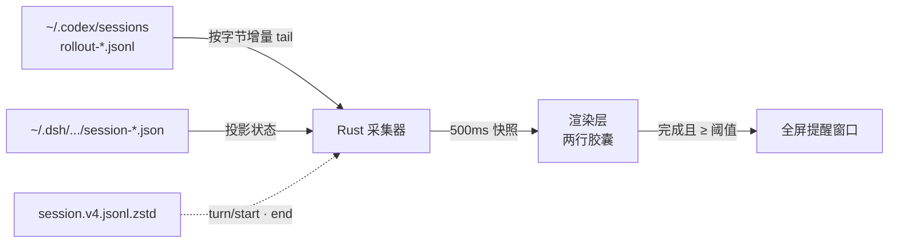

# Codex Widget · 桌面上的 AI 任务状态灯

**不切窗口，抬眼就知道 AI 跑完没有、跑了多久。**

VSCode 里让 Codex 改一个跨文件的功能，然后切去浏览器查资料——问题从来不是"它跑完了没有"，而是"我不知道它跑完了没有"。这个控件把这件事变成余光就能扫到的一颗点：跑着的时候慢慢呼吸，跑完变绿、亮一下、自己让位。

    


↑ 上排 DSH（底部一条蓝线）、下排 Codex（圆点）。数字是这一轮已经跑了多久，`×N` 是并发数。

## 这是什么

贴在屏幕右下角的一条 100px 悬浮胶囊，**只回答一个问题：现在有没有 AI 在干活，干了多久。**

它同时看两个来源，固定顺序、互相独立：

1. **DSH** —— 上排，底部一条蓝线（放一张 `whale.png` 就成了鲸鱼标记）；
2. **Codex** —— 下排，一颗圆点。

每个来源一行；同一来源多个任务时，显示最早开始的那个的时长。

## 能干什么

- **不用反复切窗口** —— 呼吸的点 + 等宽计时，余光扫一眼就知道在不在跑
- **两个来源一起看** —— DSH 与 Codex 各占一行，各自 `×N`、各自退场，互不挤占
- **跑完不用你盯着** —— 跑十分钟的任务你早就不看屏幕了，所以超过阈值（3 / 10 分钟）就换整屏提醒：压暗桌面、边缘脉冲、大字写明耗时
- **不挡事** —— 空闲时完全隐藏且鼠标穿透；完成态 5 分钟后自己淡出，也可以双击立刻收起
- **位置记得住** —— 拖到哪下次还在哪，换分辨率或拔显示器会自动回右下角
- **不碰你的 agent** —— 只读它本地写的日志，不注入、不 hook、不改配置

## Quick Start

```bash
# 1) 下载安装包（当前用户安装，无需管理员）
#    https://github.com/1053278842/codex-widget/releases/latest
# 2) 双击安装，托盘出现一颗琥珀色小点
# 3) 在 VSCode 里让 Codex 开一轮，或在本机开一个 DSH 任务 —— 胶囊就会浮出来
```

不想用安装包？[从源码构建](docs/getting-started.md#从源码构建)（Rust + Node 18+ + MSVC）。

## 用起来是什么样

| 步骤 | 你会看到 |
| --- | --- |
| 1 | 装好，托盘里一颗琥珀色小点，桌面上什么都没有 |
| 2 | AI 开跑 → 右下角浮出胶囊，标记开始呼吸，计时每 0.5s 走一次 |
| 3 | 跑完 → 标记转绿、光环扩散一次、系统通知弹出，5 分钟后自己淡出 |
| 4 | 长任务跑完 → 整屏压暗 + 边缘脉冲 + 中央卡片，随手一点或按任意键退掉 |
| 5 | 想换个位置 → 按住胶囊拖动；想立刻收起 → 双击 |

## 怎么实现的



- **Codex 侧**：逐行尾随它写的 `rollout-*.jsonl`，按 `task_started` / `task_complete` 配对；耗时直接来自事件自带的 `completed_at`，不靠外部掐表。
- **DSH 侧**：读投影缓存里的 `openTurnStartSeq`（非 null 就是"有一轮在跑"，是状态不是事件对），时间戳再从 zstd 日志里按 `turn/start` / `turn/end` 取。
- **共同点**：两边都只读文件、解析成同一个 `ThreadView`，渲染层不知道数据来自谁。

细节、踩过的坑、以及三个刻意的取舍见 [docs/architecture.md](docs/architecture.md)。

## 部署方式

| 方式 | 怎么做 | 适合 |
| --- | --- | --- |
| 安装包（推荐） | [Releases](https://github.com/1053278842/codex-widget/releases) 里的 `setup.exe` | 只想用 |
| 源码开发 | `npm install && npm run app:dev` | 改代码 |
| 自己打包 | `npm run app:build` | 出安装包分发 |

## 文档

| 文档 | 内容 |
| --- | --- |
| [getting-started](docs/getting-started.md) | 安装、从源码构建、假数据调试、环境变量、配置路径 |
| [usage](docs/usage.md) | 状态一览、两行怎么读、拖动/双击/托盘、装鲸鱼 |
| [architecture](docs/architecture.md) | 两个来源各自怎么读、三个设计取舍、项目结构 |
| [troubleshooting](docs/troubleshooting.md) | 不显示 / 不消失 / 通知署名 / 已知限制 |

## 说明

- **不是官方 API**：读的是 Codex 与 DSH 自己写的本地文件，上游改格式会读不到——它会降级成"什么也不显示"，不会误报。
- 截图是真实渲染（同一份 CSS），不是设计稿；鲸鱼图形**不在仓库里**，那是 DeepSeek 的美术资源。
- 只在 Windows 上验证过。

<details>
<summary>English</summary>

**Codex Widget** is a ~100px always-on-top capsule for Windows that tells you whether a coding agent is still running, how long it has been going, and when it finished — without switching windows.

Two sources, two stacked rows in a fixed order: DeepSeek Harness (top, marked by a blue hairline) and Codex (bottom, a dot). A mark breathes while a turn is in flight, turns green with a single halo when it lands, sends a Windows toast, and fades out after five minutes. When a turn runs past a threshold (3 or 10 minutes), a full-screen pass takes over instead: the desktop dims, the screen edge pulses (green for Codex, blue for DSH), and a large card states the elapsed time — dismissed by any click or any key.

It reads `~/.codex/sessions/**/rollout-*.jsonl` and `~/.dsh/storages/session_projcache/**` read-only; nothing is injected or hooked.

```bash
npm install && npm run app:dev
node tools/fake-session.mjs --dir .tmp/codex   # synthetic turn, no agent required
```

</details>

## License

MIT