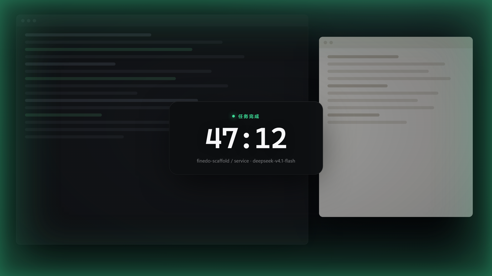
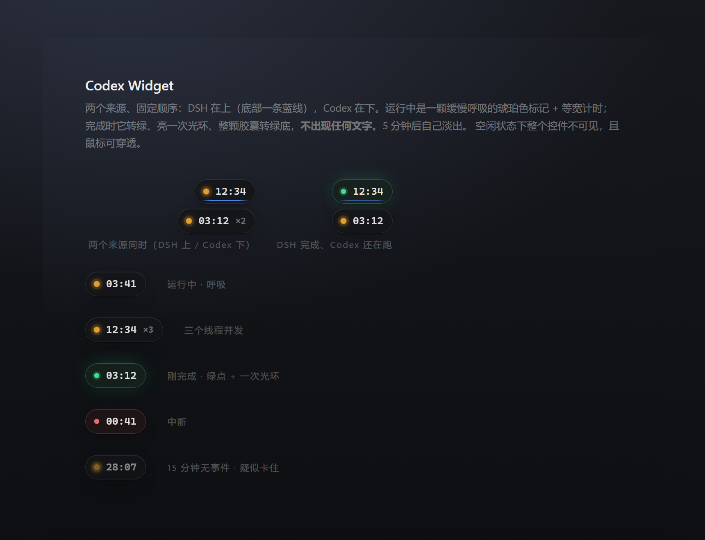

# Codex Widget

一个 100px 宽的 Windows 桌面悬浮控件：**看一眼就知道 Codex / DSH 还在不在跑、跑了多久、什么时候跑完了。**

它常驻在屏幕右下角、默认悬停于所有窗口之上，空闲时完全不可见。有任务时浮出来，用一颗缓慢呼吸的琥珀色标记 + 等宽计时器表示"还在干活"；任务结束时标记转绿、亮一次光环，同时弹出 Windows 通知，5 分钟后自己淡出。

**两个来源**，固定顺序、各自独立：

```
┌──────────────┐
│ 🐋 12:34     │  DSH    ← 底部一条蓝线（装了 whale.png 时左边是鲸鱼）
└──────────────┘
┌──────────────┐
│ ●  03:12  ×2 │  Codex  ← 圆点
└──────────────┘
```

一行一个来源；同一来源有多个任务时显示**最早开始**的那个的时长，用 `×N` 标并发数。两行各有自己的 5 分钟退场，一边跑完不会把另一边挤掉。

**超过阈值（3 / 10 分钟）的任务结束时，还会多一层全屏提醒**——因为跑了十分钟的任务，你早就不看屏幕了，右下角的小胶囊和系统通知都指望你正看着它：



整屏压暗 + 屏幕边缘脉冲（Codex 绿、DSH 蓝）+ 中央一张写清耗时的大卡片。**它会一直闪，直到你随手做点什么**——单击屏幕任何位置、或者按任意一个键，它就退场。



```
运行中   ● 12:34          ← 琥珀点呼吸，数字每 0.5s 走一次
完成     ● 03:12          ← 转绿、亮一次光环，5 分钟后淡出
中断     ● 07:08          ← 红色
并发     ● 12:34  ×3      ← 同一来源三个任务在跑，取最早那个的时长
```

> 英文简介见文末 [English](#english)。

---

## 它解决什么

VSCode 里让 Codex 改一个跨文件的功能，然后你切去浏览器查资料。**问题从来不是"它跑完了没有"，而是"我不知道它跑完了没有"**——于是每隔两分钟切回编辑器看一眼，或者干脆一直盯着。

这个控件把"当前是否有任务在跑、跑了多久"变成余光就能扫到的信息：一颗会呼吸的点。你不需要切窗口，也不需要读任何文字。

## 状态一览

| 状态 | 视觉 | 停留 |
| --- | --- | --- |
| 运行中 | 琥珀色标记，2.4s 呼吸一次，等宽字体计时 | 直到任务结束 |
| 完成 | 标记转绿、亮一次光环、胶囊转绿底，**没有任何文字** | **5 分钟，期间极其缓慢地变暗，然后自己淡出** |
| 中断 | 同上但为红色 | 同上 |
| 长任务完成 | **整屏压暗 + 边缘脉冲（Codex 绿 / DSH 蓝）+ 中央卡片写明耗时** | **一直闪，任意点击 / 任意键都关掉** |
| 并发 | 在时间后追加 `×N`，时间取**同一来源里最早开始**的那个 | 同运行中 |
| 来源 | DSH 行底部一条蓝线（可选鲸鱼标记）；Codex 行没有 | 常驻 |
| 空闲 | **完全隐藏**，并且鼠标可穿透（不会挡住底下的窗口） | — |
| 疑似卡住 | 15 分钟没有任何新事件 → 标记停止呼吸、颜色变暗 | 同运行中 |

一句话概括这个节奏：**跑 AI 的时候你随时能看到它，跑完它留一会儿让你知道结果，然后自己让位。**

长任务的阈值在托盘里选：`关闭` / `≥ 3 分钟` / `≥ 10 分钟`。

## 工作原理

Codex 的 CLI / VSCode 扩展在 `~/.codex/sessions/YYYY/MM/DD/rollout-*.jsonl` 里逐行追加结构化事件，控件只是**只读地跟随这些文件**，不注入、不 hook、不改任何东西：

| 事件 | 用途 |
| --- | --- |
| `session_meta` | 工作目录、模型、provider —— 用来判断"哪个工作区" |
| `event_msg / task_started` | 一轮任务的开始时间（unix 秒） |
| `event_msg / task_complete` | 结束时间，**自带 `completed_at`，所以耗时是精确的，不靠外部掐表** |
| `event_msg / turn_aborted` | 中断 |
| `token_usage_record`、`token_count` | 心跳：有新字节就说明这轮还活着 |
| `event_msg / user_message` | 取第一句作为任务的简短标题 |

两个工程细节值得写下来，因为它们都是踩出来的：

1. **按字节偏移增量读取，不看文件修改时间。** 实测中一个正在被追加的 rollout 文件能在 4 秒内增长 3160 字节，而它的 `LastWriteTime` 纹丝不动。所以"变了没有"只能靠 size/offset 判断。
2. **启动时从文件两端读。** 想要元数据（cwd / 模型 / 首句）得读**文件头**；想知道当前这轮是死是活，得读**文件尾**——而文件尾可能在几十 MB 之后。所以：头部读 64KB，尾部从末尾按 256KB 分块**往回扫**，直到撞上最近一个 `task_started` / `task_complete` / `turn_aborted`。

监控范围是**所有工作区的所有线程**：每次轮询扫描最近 4 天的日期目录，把每一轮的状态汇总成一个快照推给界面。

### DSH 那边不一样，而且更省事

DeepSeek Harness 本来就把状态投影成结构化数据，所以不需要尾随日志：

**状态**：`~/.dsh/storages/session_projcache/sessions/session-<id>.json`（约 8 KB，Host 每推进一次就重写）

| 字段 | 用途 |
| --- | --- |
| `rows.turnBoundary.val.openTurnStartSeq` | **非 null 就是有一轮在跑**——是个状态而不是一对事件，丢一条也不会卡住 |
| `rows.sessionStats.val.openStep` | 当前步数 + 开始时间 |
| `rows.title.val` / `modelSelection.val.lastUsed.model` | 标题、模型 |
| `identity.cwd` | 工作区 |

**时间戳**：`<session>/session.v4.jsonl.zstd`。投影里只有序号没有钟点，所以精确的 `turn/start` / `turn/end` 时间从日志里取——它是一串**拼接的 zstd 帧**（单帧解压只能拿到第一条记录），解码后按 `data.turn` 找对应的一轮；`turn/end` 的 `data.reason.kind` 是 `interrupted` 时判为中断。只在"一轮开始/结束"时解一次，之后按轮次缓存。

## 装那头鲸鱼（可选）

DSH 的蓝线是本项目自己画的，但**鲸鱼不是**——那是 DeepSeek 自己的美术资源，所以仓库里**不含**它。想要的话，把一张 PNG 放到：

```
%APPDATA%\io.github.codexwidget\whale.png
```

重启后 DSH 那一行的圆点会换成鲸鱼（仍随状态变色）。建议用**灰度+alpha**的 mask 图（28–56px），颜色由程序着色。没有这个文件时，DSH 行就用普通圆点 + 蓝线，功能完全一样。

素材可以参考 DSH 安装目录里的 `dsh-client-ui-chat/lib/assets/running-whale@2x-*.png`——仅供个人使用，别打包进公开分发。

## 安装

从 [Releases](../../releases) 下载 `Codex Widget_x.y.z_x64-setup.exe`，双击安装（当前用户安装，无需管理员）。

首次启动后它会缩在右下角（任务栏上方），**空闲时不显示任何东西**——图标在系统托盘里，一颗琥珀色的点。

## 使用

- **拖动**：按住胶囊拖到任何位置，**位置会记住**，下次启动还在原地（换了分辨率或拔了显示器就自动回到右下角）。
- **双击**：立刻收起。不双击也没关系——5 分钟后它自己会淡出。注意是**隐藏，不是退出**：托盘图标还在，下一个任务照样会浮出来。
- **全屏提醒**：单击任意处、或按任意键关掉；新的任务一开始它也会自己退场。
- **托盘右键**：
  - `显示控件` —— 关掉后任何任务都不再浮出（只保留托盘图标）
  - `完成时弹出 Windows 通知` —— 通知开关
  - `长任务全屏提醒` —— 子菜单：`关闭` / `≥ 3 分钟` / `≥ 10 分钟`
  - `开机自启` —— 写入当前用户的启动项
  - `退出`

控件本身没有面板、没有设置页、没有菜单——托盘右键就是全部设置。这是刻意的：一个 30px 高的东西不该有自己的窗口。

## 开发

前置：[Rust 工具链](https://rustup.rs)、Node.js 18+、MSVC 生成工具、WebView2 运行时（Win10/11 自带）。

```bash
npm install
npm run app:dev      # 开发模式（热更新）
npm run app:build    # 产出安装包：src-tauri/target/release/bundle/nsis/
```

### 不打扰真实 Codex 地调试

用假数据驱动，避免为了看动效而真的让 agent 跑一轮：

```bash
# 终端 A：生成一轮 12 秒后完成的任务
node tools/fake-session.mjs --dir .tmp/codex --run-seconds 12

# 终端 B：让控件读这个假目录
CODEX_WIDGET_HOME=.tmp/codex npm run app:dev
```

`--scenario abort` 演示中断态。

想立刻看到全屏提醒又不想真等十分钟，把阈值调短：

```bash
CODEX_WIDGET_LONG_SECS=5 npm run app:dev
```

### 项目结构

```
src/                 渲染层（原生 TS，无框架）
  main.ts            状态机：idle / run / done / aborted + 8s 收尾
  styles.css         胶囊的全部视觉，含呼吸动画与 A′ 展开
  overlay.ts         长任务的全屏提醒：播放 5.6s 序列后请求隐藏窗口
  overlay.css        全屏层：压暗、边缘脉冲、中央卡片
overlay.html         第二个 webview（全屏提醒），与胶囊共用同一份构建
src-tauri/
  src/main.rs        托盘、两个窗口的机制、设置持久化、命令
  src/watcher.rs     rollout jsonl 的增量跟随与 turn 状态机
tools/
  fake-session.mjs   合成事件流，用于演示与测试
  make-icons.ps1     用 System.Drawing 生成 app / tray 图标
```

## 已知限制

- **不是官方 API。** 它读的是 Codex 自己写的日志，属于私有格式。已验证于 Codex CLI `0.169.0-alpha.11.1` + VSCode 扩展 `26.1111.21308`，并在 100 个真实会话、单个 27MB 的 rollout 文件上做过回归。上游改格式时这里会读不到——它会显式降级为"什么也不显示"，而不是乱猜。
- **"疑似卡住"是启发式。** 15 分钟无新事件即视为停滞。一个长思考、无工具调用的回合有可能被误判为暗色；事件一到就恢复呼吸。
- **只在 Windows 上验证过。** 代码里没有 Windows 特有的硬编码，但 macOS / Linux 的托盘、开机自启、通知行为未测试。
- **拖动是 JS 实现的**（跟着指针算偏移再 `setPosition`），不是系统原生的窗口拖动。这样双击才能同时存在；代价是极快甩动时可能有一两帧滞后。
- **开发态运行通知会署名 "Windows PowerShell"**——因为进程没有注册的 AppUserModelID 兜底。用安装包装好后署名与图标都正确（`Codex Widget` + 自己的图标）。

## English

**Codex Widget** is a ~100px always-on-top capsule for Windows that tells you whether a Codex task is still running, how long it has been running, and when it finishes — without switching windows.

An amber dot breathes while a turn is in flight, a monospace timer ticks beside it, the capsule expands sideways into `完成 3:12` when the turn lands (with a one-shot green halo and an optional Windows toast), then collapses and disappears 8 seconds later. Idle means invisible *and* click-through.

When a turn ran **10 minutes or longer** — long enough that you had stopped watching — a full-screen pass takes over instead: the desktop dims, the screen edge pulses green three times, and a large card states how long it took. It is click-through, never takes focus, and clears itself after 5.6s.

It reads `~/.codex/sessions/**/rollout-*.jsonl` read-only, following the same `task_started` / `task_complete` / `turn_aborted` records the CLI writes — byte-offset incremental tailing, never file mtimes.

```bash
npm install && npm run app:dev
node tools/fake-session.mjs --dir .tmp/codex   # synthetic turn, no agent required
```

## License

MIT