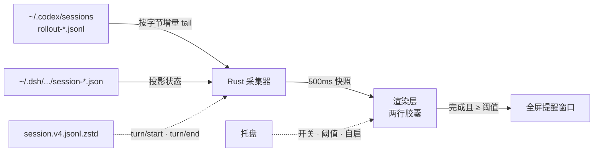

# 实现

## 一句话

Rust 侧每 500ms 读一次两个 agent 的本地状态文件，把它们折成同一种 `ThreadView`，推给渲染层；渲染层只负责画两行胶囊。



## Codex：尾随日志

Codex 的 CLI / VSCode 扩展在 `~/.codex/sessions/YYYY/MM/DD/rollout-*.jsonl` 里逐行追加结构化事件，控件只是**只读地跟随这些文件**，不注入、不 hook、不改任何东西：

| 事件 | 用途 |
| --- | --- |
| `session_meta` | 工作目录、模型、provider —— 用来判断"哪个工作区" |
| `event_msg / task_started` | 一轮任务的开始时间（unix 秒） |
| `event_msg / task_complete` | 结束时间，**自带 `completed_at`，所以耗时是精确的，不靠外部掐表** |
| `event_msg / turn_aborted` | 中断 |
| `token_usage_record`、`token_count` | 心跳：有新字节就说明这轮还活着 |
| `event_msg / user_message` | 取第一句作为任务的简短标题 |

两个工程细节值得写下来，因为它们都是踩出来的：

1. **按字节偏移增量读取，不看文件修改时间。** 实测中一个正在被追加的 rollout 文件能在 4 秒内增长 3160 字节，而它的 `LastWriteTime` 纹丝不动。所以"变了没有"只能靠 size/offset 判断。
2. **启动时从文件两端读。** 想要元数据（cwd / 模型 / 首句）得读**文件头**；想知道当前这轮是死是活，得读**文件尾**——而文件尾可能在几十 MB 之后。所以：头部读 64KB，尾部从末尾按 256KB 分块**往回扫**，直到撞上最近一个 `task_started` / `task_complete` / `turn_aborted`。

监控范围是**所有工作区的所有线程**：每次轮询扫描最近 4 天的日期目录，把每一轮的状态汇总成一个快照推给界面。

## DSH：读投影，不解事件流

DeepSeek Harness 本来就把状态投影成结构化数据，所以不需要尾随日志：

**状态**：`~/.dsh/storages/session_projcache/sessions/session-<id>.json`（约 8 KB，Host 每推进一次就重写）

| 字段 | 用途 |
| --- | --- |
| `rows.turnBoundary.val.openTurnStartSeq` | **非 null 就是有一轮在跑**——是个状态而不是一对事件，丢一条也不会卡住 |
| `rows.sessionStats.val.openStep` | 当前步数 + 开始时间 |
| `rows.title.val` / `modelSelection.val.lastUsed.model` | 标题、模型 |
| `identity.cwd` | 工作区 |

**时间戳**：`<session>/session.v4.jsonl.zstd`。投影里只有序号没有钟点，所以精确的 `turn/start` / `turn/end` 时间从日志里取——它是一串**拼接的 zstd 帧**（单帧解压只能拿到第一条记录），解码后按 `data.turn` 找对应的一轮；`turn/end` 的 `data.reason.kind` 是 `interrupted` 时判为中断。只在"一轮开始/结束"时解一次，之后按轮次缓存。

## 三个刻意的设计取舍

| 选择 | 为什么 |
| --- | --- |
| 拖动用 JS 实现（指针捕获 + `setPosition`），不用 `data-tauri-drag-region` | 后者会把胶囊变成"窗口标题栏"，Windows 会把双击的第二次点击转成 `WM_NCLBUTTONDBLCLK`，网页层永远收不到——而双击是收起手势。JS 拖动还能用 4px 阈值把"按住不动"留给点击 |
| 完成态用"截止时间 + 500ms 心跳"退场，不用一次 `setTimeout(5min)` | Chromium 会节流被遮挡窗口的定时器，而主窗口恰好会被全屏提醒盖住，5 分钟的定时器会迟到很多 |
| 全屏提醒是独立窗口，且自己抢焦点 | 抢焦点才能收到"任意键关闭"；既然任何输入都退场，就不需要保持点击穿透 |

## 项目结构

```
src/                 渲染层（原生 TS，无框架）
  main.ts            两行胶囊的状态机 + 拖动 + 5 分钟退场
  styles.css         胶囊的全部视觉，含呼吸动画与 DSH 蓝线
  overlay.ts         全屏提醒：播放序列，任意输入请求关闭
  overlay.css        全屏层：压暗、边缘脉冲、中央卡片
overlay.html         第二个 webview（全屏提醒），与胶囊共用同一份构建
src-tauri/
  src/main.rs        托盘、两个窗口的机制、设置持久化、命令
  src/watcher.rs     Codex rollout 的增量 tail 与 turn 状态机
  src/dsh.rs         DSH 投影缓存轮询 + zstd 帧解码取时间戳
tools/
  fake-session.mjs   合成 Codex 事件流，用于演示与测试
  make-icons.ps1     用 System.Drawing 生成 app / tray 图标
```

## 验证范围

已在 Codex CLI `0.169.0-alpha.11.1` + VSCode 扩展 `26.1111.21308` 上验证；用 100 个真实会话、单个 27 MB 的 rollout 文件做过回归。DSH 侧对着真实会话验证过运行/完成/中断三态。